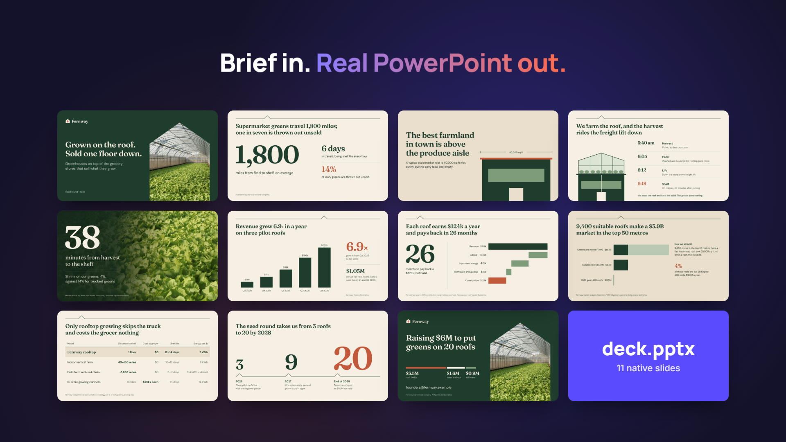
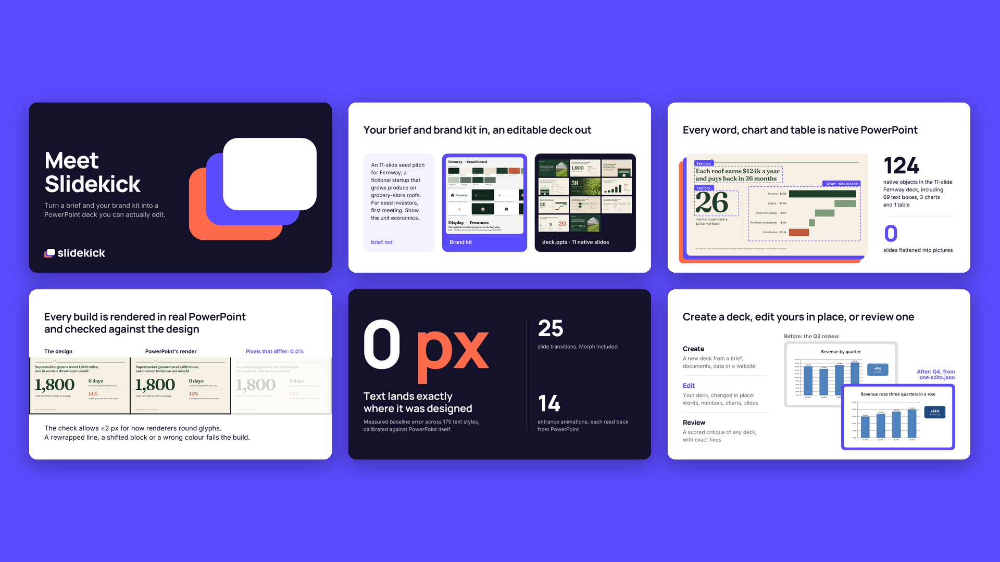
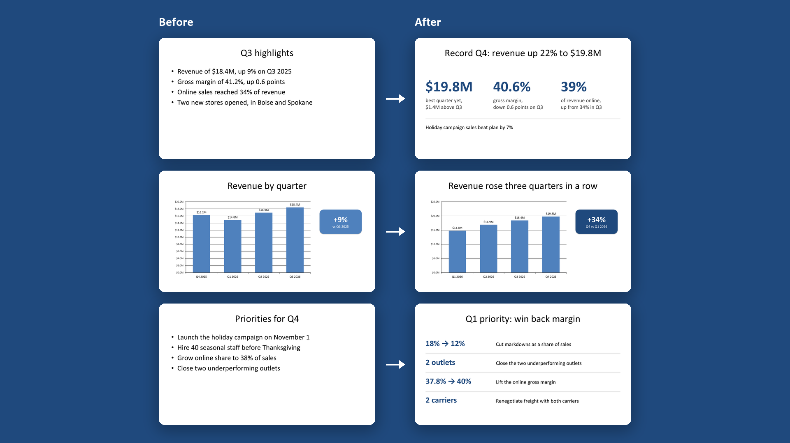

# Slidekick

**Your slide sidekick. Brief in, real PowerPoint out: on your brand, every word editable.**

[](https://aarshx05.github.io/slidekick/)

**Slidekick** (`/slidekick`) is an agent skill that makes **fully editable, on-brand PowerPoint decks** from a brief, your docs, a spreadsheet, a code project or a website. It also **edits the decks you already have** without breaking their formatting, and **reviews any deck** like a design director would.

There are no screenshots pasted onto slides. Every headline is a real text box, every chart has its data in an embedded workbook, and every transition (Morph included) is native. Before you see the deck, `/slidekick` renders it in real PowerPoint and checks it against the design. Then a fresh pair of eyes reviews it.

[](https://github.com/aarshx05/slidekick/actions/workflows/ci.yml) [](LICENSE)

## Install

**Claude Code:**

```bash
/plugin marketplace add aarshx05/slidekick
/plugin install slidekick@slidekick
```

**Codex:**

```bash
codex plugin marketplace add aarshx05/slidekick
codex plugin add slidekick@slidekick
```

**Any other agent:** one command with the [`skills`](https://github.com/vercel-labs/skills) CLI (Cursor, Copilot, Gemini CLI, opencode and more):

```bash
npx skills add https://github.com/aarshx05/slidekick --skill slidekick
```

Add `-g` to install it globally.

<details>
<summary>No installer? Copy the skill directly.</summary>

```bash
git clone https://github.com/aarshx05/slidekick
rsync -a --exclude "__pycache__" slidekick/skills/slidekick/ ~/.claude/skills/slidekick/
```

On Windows (PowerShell): `Copy-Item -Recurse slidekick\skills\slidekick "$env:USERPROFILE\.claude\skills\slidekick"`. Restart your agent afterwards.
</details>

<details>
<summary>Also works with Antigravity, opencode, and anything that reads skills</summary>

The repo exposes the skill at each agent's standard discovery path, so agents find it without extra config.

| Agent | How it discovers `/slidekick` |
|---|---|
| **Claude Code** | the plugin above, or `.claude/skills/slidekick/` |
| **Codex CLI** | the plugin above, or `.agents/skills/slidekick/` |
| **Google Antigravity** | `.agents/skills/slidekick/` in a project, or `~/.gemini/config/skills/slidekick/` |
| **opencode** | `.opencode/skills/slidekick/` |
| **Anything else** | point its custom instructions at `skills/slidekick/SKILL.md`. See [`docs/other-agents.md`](docs/other-agents.md) |

> **Windows:** the discovery paths are symlinks. Clone with `git clone -c core.symlinks=true` (this needs Developer Mode), or copy `skills/slidekick/` into place as shown above.
</details>

## Use it

Ask your agent in plain words:

```text
/slidekick make a 10-slide seed pitch from this repo and the notes in docs/
```

```text
/slidekick --brand ./brand-kit a quarterly review from q3.xlsx for the board
```

```text
update the Q3 numbers in board-review.pptx to Q4 and keep everything else as it is
```

```text
review this deck and tell me what to fix before Friday
```

You get a `deck.pptx` that opens and edits like one you built by hand. Alongside it are the plan, a contact sheet, a QA report and the design review.

| Option | What it does |
|---|---|
| `--brand <kit>` | logos, colours, fonts, a `.potx`/`.pptx` template, design tokens, a guidelines PDF: whatever you have |
| `--audience`, `--tone` | who it's for and how it should sound |
| `--mode presented\|read` | slides for a speaker, or a deck that stands on its own |
| `--slides 10` / `--minutes 15` | how long |
| `--transitions`, `--animations` | how much motion (Morph included) |

## Three modes

| Mode | You say | It does |
|---|---|---|
| **Create** | "make a deck about …" | brief → story → slides → native `.pptx` → checked in PowerPoint → design review |
| **Edit** | "update the numbers", "replace slide 5", "swap the screenshot" | reads your deck, then changes only what you asked: text, charts, tables, images, styling, slide order. Masters, fonts and untouched slides stay exactly as they were |
| **Review** | "critique this pitch", "summarise this deck" | outline, real renders, mechanical issues, story analysis and a scored design review, for any `.pptx`, `.ppt`, `.odp` or `.pdf` |

## Gallery

Every example is in [`examples/`](examples/), with its brief, plan, canvas, QA report and design review. Each one rebuilds from its own folder.

| [Meet Slidekick](examples/demo-deck/) | [Fernway seed pitch](examples/pitch-deck/) | [Edit: Q3 → Q4](examples/edit-before-after/) |
|---|---|---|
| [](examples/demo-deck/) | [](examples/pitch-deck/) | [](examples/edit-before-after/) |
| the launch deck for this skill, on the demo brand kit | charts, a table, Morph and a brand built from scratch | an ordinary deck updated in place: same template, new numbers |

## Why it's different

- **Editable or it doesn't ship.** Slides are designed in HTML/CSS. Chromium solves the layout, and each element compiles to a *native* PowerPoint object: text boxes with real runs and bullets, shapes, vector SVG, tables, charts with embedded data, groups, transitions and animations.
- **Proof, not hope.** PowerPoint renders the finished file and `/slidekick` pixel-diffs it against the design. It reads back what PowerPoint parsed (transitions, animations, overflowing text) and fixes problems before you ever open the file.
- **On brand from your kit.** Give it a `.potx` and it builds on your masters, theme colours and fonts. Give it a website and it uses that site's identity.
- **Reviewed by fresh eyes.** A lint measures what a design director catches: near-miss alignment, jumping headlines, runts, type-scale sprawl, off-palette colour, the tells of an AI-made deck. A separate reviewer that never saw the code then scores 8 dimensions. Nothing ships with a blocker or a score below 4/5.

<details>
<summary>How it works</summary>

```
Source (brief, docs, data, project, URL)
  → Semantic analysis   content · brand kit · audience          plan/brief.md
  → Story               beats                                    plan/narrative.json
  → Slides              one idea per slide                       plan/slides.json
  → Canvas              HTML/CSS → Chromium geometry             canvas/deck.html → build/layout.json
  → Compile             python-pptx + OOXML patches              deck.pptx
  → Render              PowerPoint (LibreOffice fallback)        build/render/
  → QA                  pixel diff vs design + checks            qa/report.md, qa/contact-sheet.png
  → Fix                 rebuild (≤ 3 rounds)
  → Review              taste lint + fresh-eyes design review    qa/taste.md, qa/review.json (≤ 2 rounds)
```

| Piece | Role |
|---|---|
| **Chromium** (your Edge/Chrome, via Playwright) | the layout engine. It reads exact boxes, computed styles, text runs, baselines and the font that actually rendered each run |
| **python-pptx + an OOXML patcher** | native shapes, text, pictures, tables and charts, plus hand-written XML for what python-pptx lacks: transitions (p14/p15/p159 with fallbacks), animation timing, SVG, theme colours and fonts, gradients, shadows, letter-spacing |
| **PowerPoint** | the ground-truth renderer: COM on Windows, AppleScript on Mac |
| **Baseline calibration** | PowerPoint places text non-linearly, so each text style is measured once in real PowerPoint and cached |

**Fidelity, measured on PowerPoint 16 for Windows:**
- 0 px residual baseline error across 175 calibrated text styles (before calibration it was up to 8 px)
- 25 transitions (Morph by object, word and character included) and 14 entrance animations, every one parsed by PowerPoint with click/with/after triggers
- line breaks match Chromium's exactly
- QA forgives ±2 px of renderer jitter but fails a missing or rewrapped headline, a shifted block, or a wrong colour
</details>

## Requirements

- An agent that supports skills: Claude Code, Codex, opencode, Antigravity, Cursor or [others](docs/other-agents.md)
- Python 3.10+. The first run creates a private environment and installs everything else
- Edge or Chrome (or `python -m playwright install chromium`)
- **PowerPoint** for ground-truth QA (optional: without it, LibreOffice gives an approximate check)

| | Windows | macOS | Linux |
|---|---|---|---|
| Create, Edit, Review | ✅ | ✅ | ✅ |
| QA renderer | PowerPoint | PowerPoint for Mac **(beta)** | LibreOffice (approximate) |
| Transition/animation readback | ✅ | XML check only | XML check only |
| Text-overflow check after an edit | measured by PowerPoint | visual | visual |

To check your machine: `python <skill-dir>/scripts/deck.py doctor`. On a Mac, the first render asks to let your terminal control PowerPoint. Allow it.

## Privacy

Everything runs on your machine. `/slidekick` only goes online to install its Python packages on first run, to fetch a Google Font you ask for, or to capture a URL you give it. Your documents and decks are never uploaded anywhere.

## Limitations

- Slides are 16:9. A template with a different aspect ratio is scaled to its width.
- Some CSS isn't exported: filters, blend modes, `scale()`/skew, stacked background gradients, per-corner radii, and `::before`/`::after`. The tool warns when it meets one.
- Edit mode can't change SmartArt, OLE objects, video, or masters in place, and it can't add table rows or columns. Rebuild those slides instead.
- `--embed-fonts` is experimental. Recipients should have the brand fonts installed.
- PDF decks can be reviewed but not edited.

## Uninstall

```bash
python <skill-dir>/scripts/deck.py uninstall           # removes the private environment and caches
python <skill-dir>/scripts/deck.py uninstall --fonts   # …and the fonts /slidekick installed
```

Then remove the plugin with `/plugin uninstall slidekick@slidekick`.

## What's in this repo

- `skills/slidekick/`: the skill. `SKILL.md` (Create / Edit / Review), `references/` (step guides, design guide, review rubric), `scripts/` (the pipeline) and `assets/` (the starter canvas)
- `examples/`: the gallery decks, each rebuildable from its own folder
- `docs/`: the [launch site](https://aarshx05.github.io/slidekick/) (GitHub Pages)
- `tests/`: pytest suite, run in CI on Windows, macOS and Linux
- `.claude-plugin/`, `.codex-plugin/`, `plugin.json`: plugin manifests for Claude Code, Codex and Agent Plugins
- `.claude/skills/slidekick`, `.agents/skills/slidekick`, `.opencode/skills/slidekick`: symlinks to `skills/slidekick/` for auto-discovery

## Credits

- Demo fonts: [Manrope](https://fonts.google.com/specimen/Manrope), [Inter](https://fonts.google.com/specimen/Inter), [Fraunces](https://fonts.google.com/specimen/Fraunces) and [DM Sans](https://fonts.google.com/specimen/DM+Sans), all SIL Open Font License
- Built on [python-pptx](https://github.com/scanny/python-pptx), [Playwright](https://playwright.dev), [PyMuPDF](https://pymupdf.readthedocs.io) and [fontTools](https://github.com/fonttools/fonttools)
- Launch video made with [/brag](https://github.com/latent-spaces/brag)

## Contributing

Ideas, bug reports, new example decks and PRs are welcome. See [CONTRIBUTING.md](CONTRIBUTING.md). Please include `deck.py doctor` output with bug reports.

## License

[MIT](LICENSE)
